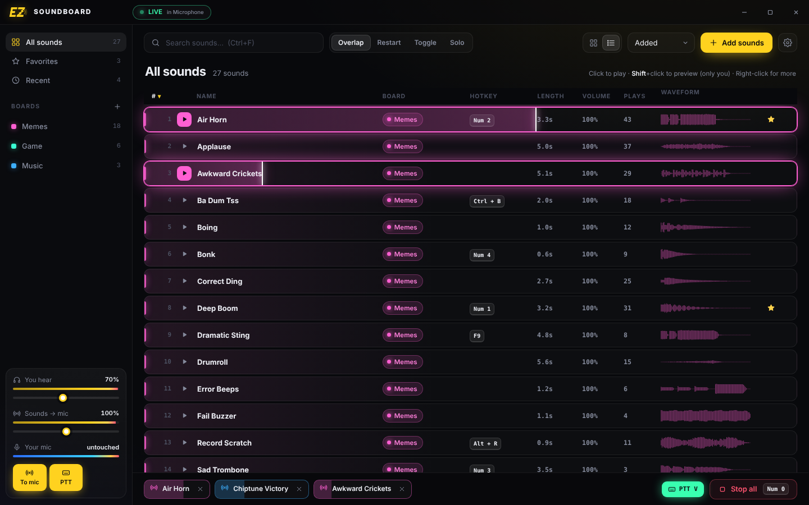
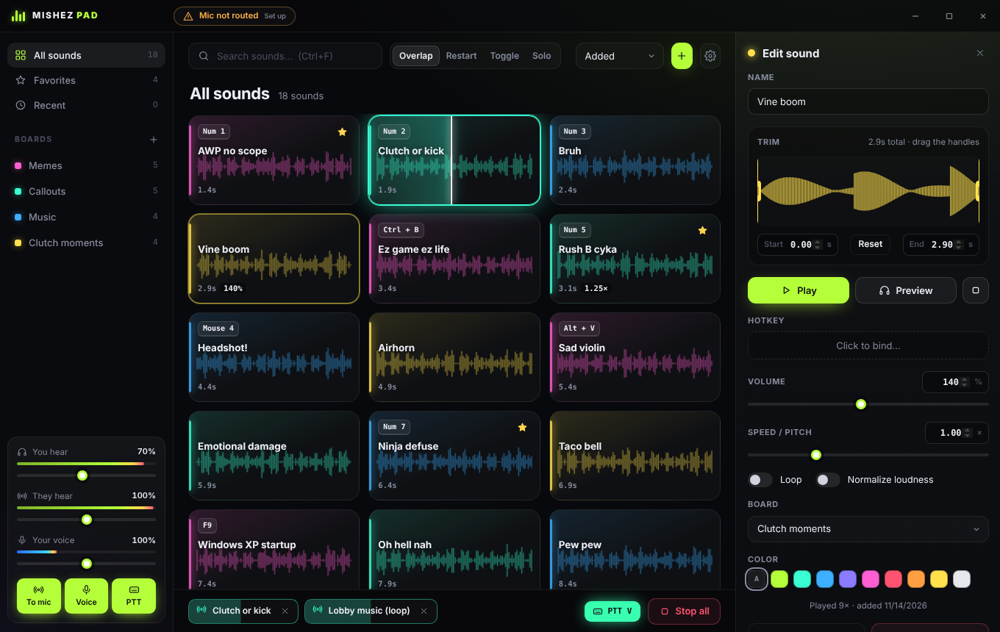
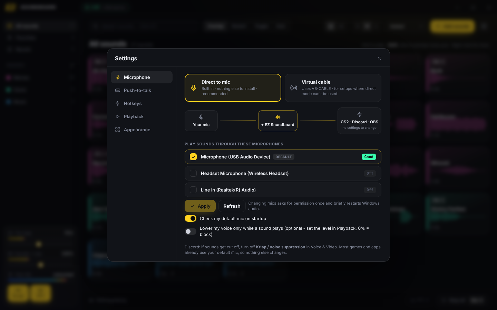
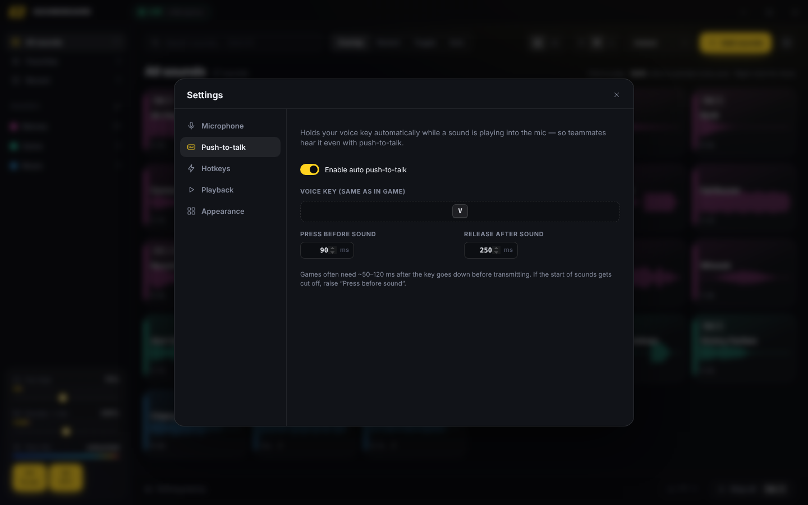

# EZ Soundboard

A modern Windows soundboard that plays sounds **through your microphone**, similar to Soundpad, but with a fresh UI and a few extras.


| List view | Sound editor |
|---|---|
|  |  |
| **Microphone (direct mode)** | **Auto push-to-talk** |
|  |  |

## Features
- **Plays straight into your real mic**: nothing else to install. Your voice keeps working in every game and in Discord. A VB-CABLE mode is still available as a fallback.
- **Voice control**: mute, boost or duck your real voice while sounds play (set the duck level to 0% to block your voice, like Soundpad's "Block voice").
- **Auto push-to-talk**: holds your in-game voice key (keyboard or Mouse 4/5) while a sound plays, with adjustable pre-press and release timing.
- **Global hotkeys that pass through to the game**: the keys still reach the game, and Mouse 4/5 can be bound. This uses `uiohook-napi`, and the app falls back to Electron's built-in shortcuts if that isn't available.
- **Per-sound settings**: trim with draggable handles on the waveform, volume up to 300%, speed/pitch, loop, loudness normalization, color and board.
- **Play modes**: Overlap, Restart, Toggle (press again to stop) and Solo.
- **Limiter** on the mic output, so loud sounds don't clip into distortion.
- **Boards (categories)**: drag pads onto a board in the sidebar to move them. There are also Favorites, a Recent list, search, sorting and three pad sizes.
- **Live view**: progress on every playing pad, a now-playing bar, and level meters for what you hear, what others hear, and your voice.
- **Import**: drag and drop files or whole folders. Supported formats: mp3, wav, ogg, flac, m4a, aac, opus and webm.
- **Background mode**: the app keeps running in the system tray. Hotkeys work while it's hidden, and Shift+click previews a sound so only you hear it.
- **Auto-detects VB-CABLE** on first launch and shows a setup guide if it isn't installed.
- **Text to speech**: type something and it plays into your mic in any Windows voice. Preview it first, or save a phrase to your board as a normal sound.
- **Stream Deck**: put sounds on keys. Keys show the sound's name and light up while it plays. There are also Stop all, Text to speech and Sounds to mic on/off keys.
- **Add from a link**: paste a link (Ctrl+V anywhere) or drag one in from the browser. Works with direct audio links, Discord attachments, Dropbox / Google Drive / GitHub share links, and sound pages like myinstants.com.
- **Updates inside the app**: when a new version is out, an Update button appears in the title bar. One click downloads it and it installs on restart.

## How sounds reach your mic (no VB-CABLE)
EZ Soundboard installs a small audio plugin (a Windows **APO**, the same technique Soundpad uses) into your real microphone. Windows runs it inside its own audio engine and it adds EZ Soundboard's sounds on top of your voice. Every app that records that mic hears your voice **and** the sounds: CS2, Discord, OBS, anything. You don't change any game settings.

It improves on Soundpad in two ways:
- **Overlapping sounds work.** EZ Soundboard mixes the sounds itself, then streams the finished mix to the plugin.
- **Several voice apps at once work.** Each app recording the mic (for example CS2 and Discord) gets its own full copy of the sounds.

## For players: install
1. Download `EZ-Soundboard-Setup-x.y.z.exe` from [Releases](https://github.com/TheMishez/EZ_SoundBoard/releases/latest) and run it.
2. Click **Yes** on the single Windows permission prompt.

That's it. The installer turns EZ Soundboard on for your default microphone. To use other mics, go to Settings → Microphone, tick them and click **Apply**. If you later change your default mic, the app offers to enable the new one when it starts. Uninstalling restores your mics exactly as they were.

**Discord:** if sounds get cut off, turn off Krisp / noise suppression in Voice & Video.

**Updates:** EZ Soundboard checks GitHub when it starts and every 6 hours. When there's a new version, click **Update** in the title bar (or Settings → Updates). Windows asks once for permission, then the app restarts on the new version with your sounds and settings unchanged.

**Stream Deck:** Settings → Stream Deck → **Install Stream Deck plugin**, then drag *EZ Soundboard → Play sound* onto a key and pick a sound. EZ Soundboard has to be running for the keys to work.

## For you: building the installer
Option A (easiest): push the repo to GitHub. The included workflow (`.github/workflows/release.yml`) builds everything on GitHub's Windows machines. Download the installer from the run's **Artifacts**.

To ship an update to everyone: bump `version` in `package.json`, then publish a GitHub release tagged `vX.Y.Z` with the same number. The workflow attaches the installer and `latest.yml`, and the app picks it up. See [docs/SIGNING.md](docs/SIGNING.md) for the full steps and for free code signing.

Option B (on your PC):
1. Install **Node.js 20+** and **Visual Studio 2022 Build Tools** with the *Desktop development with C++* workload (includes CMake and the Windows SDK).
2. Run:
   ```
   npm install
   npm run dist        # builds the C++ plugin, the Stream Deck plugin, then the installer in dist/
   ```
3. For development: run `npm run build:native` once, then `npm start`. Enable your mic in Settings → Microphone.

### Native parts (`native/`)
| File | Does |
|---|---|
| `EZSoundboardApo.dll` | The mic plugin. Passes your voice through and adds the sound mix from shared memory. |
| `ezsb-bridge.exe` | Started by the app. Streams the app's sound mix into shared memory. |
| `ezsb-mic-setup.exe` | Enables or disables the plugin on mics (`list`, `install default`, `uninstall all`). It backs up the original mic settings first and restarts Windows Audio. Logs: `%ProgramData%\EZSoundboard\` (setup.log, apo.log, bridge.log) |

### Troubleshooting direct mode
- **Settings → Microphone shows "Ready" but never "Good":** no app is recording that mic. Open Discord's mic test, or check that the right mic is the Windows default.
- **A specific mic driver ignores the plugin:** run `ezsb-mic-setup.exe install <guid> --sfx` (stream slot) or `--legacy` (older slot) as admin, or switch that PC to **Virtual cable** mode in Settings.
- **Mic has no sound at all after enabling:** run `ezsb-mic-setup.exe uninstall all` as admin (or uninstall the app). Every change is reversible from the backup.
- **Windows warns about the installer:** builds are unsigned until SignPath signing is set up, so Windows SmartScreen shows a warning. See [docs/SIGNING.md](docs/SIGNING.md).

## Starter sounds (pre-installed)
Put audio files in `assets/starter-sounds/`. Each subfolder becomes a board (`Memes/`, `Callouts/`, `Music/`...). They ship inside the installer and are added to every new user's library on first launch, and users can re-add them from **Add sounds → Add starter sounds**. Only ship sounds you have the rights to distribute.

## Push-to-talk games
Go to Settings → Push-to-talk, turn it on and bind the same key you use for voice in the game (for example `V` or `Mouse 4`). If the start of sounds gets cut off, raise **Press before sound** to 120–150 ms.

## Stream Deck and other tools
The Stream Deck plugin lives in `streamdeck/` and is packed with `npm run pack:streamdeck` (`tools/make_streamdeck_images.py` redraws its key images). It talks to EZ Soundboard on `127.0.0.1:41720`, which only programs on the same PC can reach. Every request needs the header `X-EZSB: 1`:

| Request | Does |
|---|---|
| `GET /v1/sounds` | Lists sounds: id, name, board |
| `GET /v1/state` | Which sounds are playing, and whether sounds go to the mic |
| `POST /v1/play` `{"id": "..."}` or `{"name": "air horn"}` | Plays a sound |
| `POST /v1/stop` `{"id": "..."}` / `POST /v1/stopall` | Stops one sound / everything |
| `POST /v1/tts` `{"text": "gg"}` | Says the text into the mic |
| `POST /v1/mic` `{"on": true}` | Sounds to mic on/off (toggles without `on`) |

Turn it off in Settings → Stream Deck if you don't use it.

## Code signing policy
Free code signing provided by [SignPath.io](https://about.signpath.io), certificate by [SignPath Foundation](https://signpath.org) (once the project is accepted; see [docs/SIGNING.md](docs/SIGNING.md)).

## Notes
- `uiohook-napi` makes hotkeys work without blocking the key in your game. If it fails to install, the app falls back to Electron's built-in shortcuts, which take the key away from the game.
- The sound library is stored in `%APPDATA%/EZ Soundboard/`.
- Some anti-cheat systems (FACEIT, Vanguard) may ignore the key presses that auto push-to-talk sends. Sounds still go into the mic.

## Project layout
```
src/main/main.js       window, tray, library storage, file import
src/main/hotkeys.js    global hotkeys (uiohook pass-through / globalShortcut fallback)
src/main/ptt.js        auto push-to-talk (keybd_event / mouse_event via a PowerShell helper)
src/main/apo.js        direct-to-mic: runs the setup tool (elevated) and the audio bridge
src/main/updater.js    in-app updates from GitHub Releases (electron-updater)
src/main/tts.js        text-to-speech with the Windows voices (PowerShell)
src/main/linkimport.js "Add from link" downloads
src/main/remote.js     local control server for the Stream Deck plugin
src/renderer/js/extras.js  updates, text-to-speech, add-from-link and Stream Deck UI
streamdeck/            the Stream Deck plugin (packed by tools/pack-streamdeck.js)
native/                C++ mic plugin, bridge and setup tool (CMake)
build/installer.nsh    one-click installer hooks (enable on install, restore on uninstall)
src/main/preload.js    safe IPC bridge
src/renderer/js/audio.js  dual-output audio engine (headphones + virtual mic, passthrough, limiter, ducking)
src/renderer/js/app.js    UI
src/renderer/styles.css   look & feel
```
